# 2. Modelo UML — casos de uso, secuencia, actividad, estados y clases

Cada diagrama se entrega en **dos formatos** (misma semántica):
**Mermaid** (renderiza en GitHub/VS Code/Obsidian sin instalar nada) y
**PlantUML** (estándar académico; renderiza en plantuml.com o con la
extensión de VS Code).

Actores definidos en doc 01 §3. Requerimientos trazados en doc 01 §9.
**v2 (25-10-2026):** los CU-12…CU-16 (multi-rol, perfiles, timeline) y sus
flujos viven en §2.7; los diagramas v1 (§2.1–2.5) no cambian.

---

## 2.1 Diagrama de casos de uso

### Mermaid

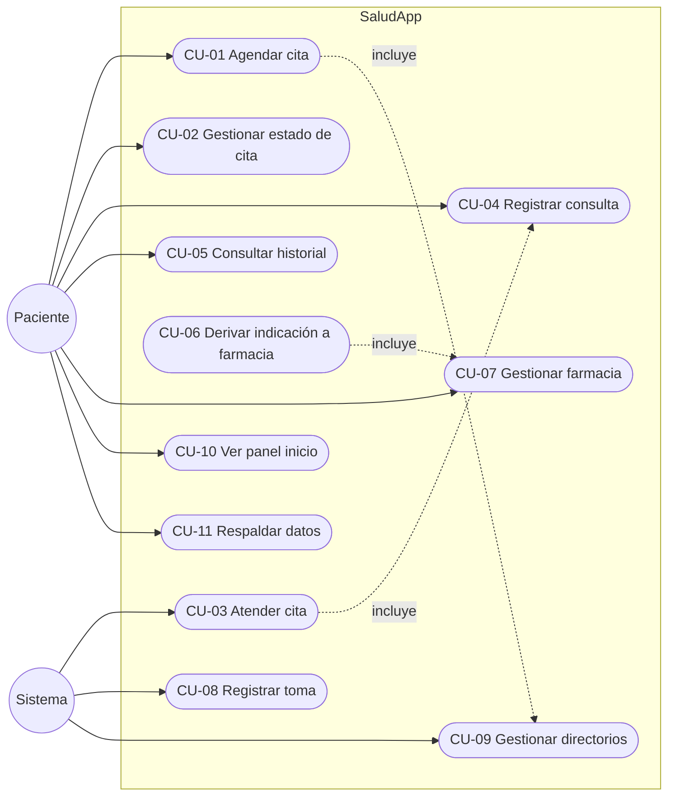

### PlantUML

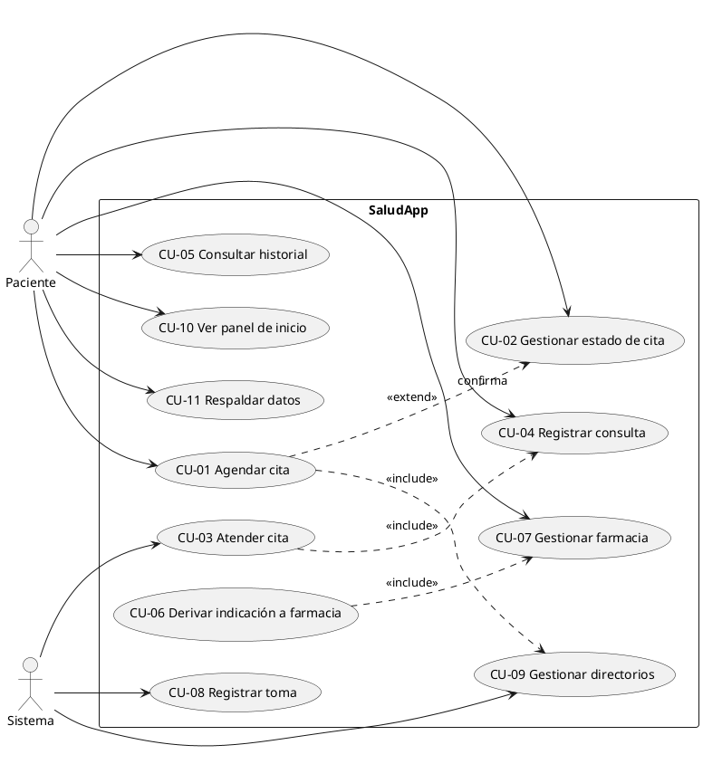

### Casos de uso ampliados (los 3 principales)

**CU-01 Agendar cita (RF-01, RF-02, RF-14)**
| | |
|---|---|
| Actor | Paciente |
| Precondición | Saludo en Inicio; botón "Agendar cita" disponible |
| Flujo principal | 1) Toca **+ Agendar cita** · 2) Elige médico (existente o nuevo → CU-09) · 3) Elige especialidad · 4) Elige fecha/hora · 5) Ingresa consultorio · 6) Confirma · 7) El sistema valida traslape (RF-02) y guarda con estado `Programada` · 8) Inicio muestra la cita como "Próxima cita" |
| Flujo alternativo | 7a) Traslape detectado → error "Ya hay una cita con ese médico a esa hora" → vuelve a paso 4 |
| Postcondición | Cita persistida en `cita` (estado `Programada`) |

**CU-03 Atender cita (RF-05, RF-06)**
| | |
|---|---|
| Actor | Paciente (dispara), Sistema (crea consulta) |
| Precondición | Cita en `Programada` o `Confirmada` |
| Flujo principal | 1) Abre detalle de cita · 2) Toca **Marcar atendida** · 3) Sistema transiciona cita a `Atendida` (R1) · 4) Sistema abre formulario de consulta precargado (médico/especialidad/fecha) · 5) Paciente escribe motivo, **diagnóstico** e **indicaciones** · 6) Guarda (RF-06) → consulta queda vinculada 1:1 a la cita (R2) |
| Postcondición | `consulta` creada; cita `Atendida`; historial actualizado |

**CU-08 Registrar toma (RF-11, R3)**
| | |
|---|---|
| Actor | Paciente |
| Flujo principal | 1) En Farmacia toca **Tomar** en un medicamento activo · 2) Sistema valida stock > 0 (R3) · 3) Descuenta 1 a stock · 4) Registra `toma` con fecha-hora · 5) Actualiza adherencia del día |
| Alternativo | 2a) Stock 0 → aviso "sin existencias" + opción "sí tomar (marcado manual)" |

---

## 2.2 Diagramas de secuencia (3 flujos críticos)

### S1 — Agendar cita con validación de traslape

**Mermaid**
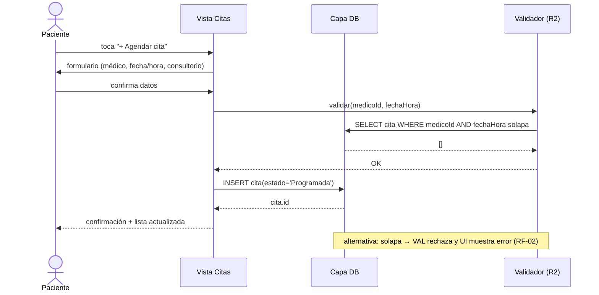

**PlantUML**
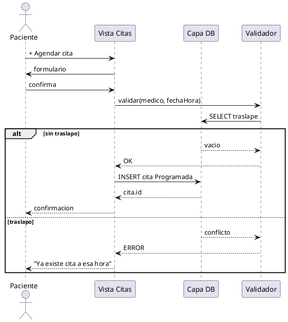

### S2 — Atender cita y registrar consulta (diagnóstico + indicaciones)

**Mermaid**
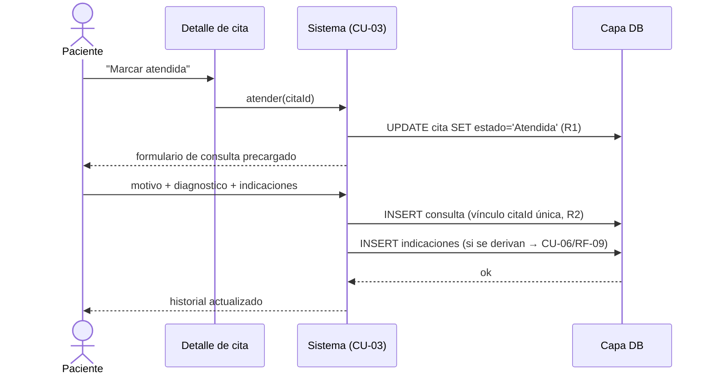

### S3 — Registrar toma y descontar stock

**Mermaid**
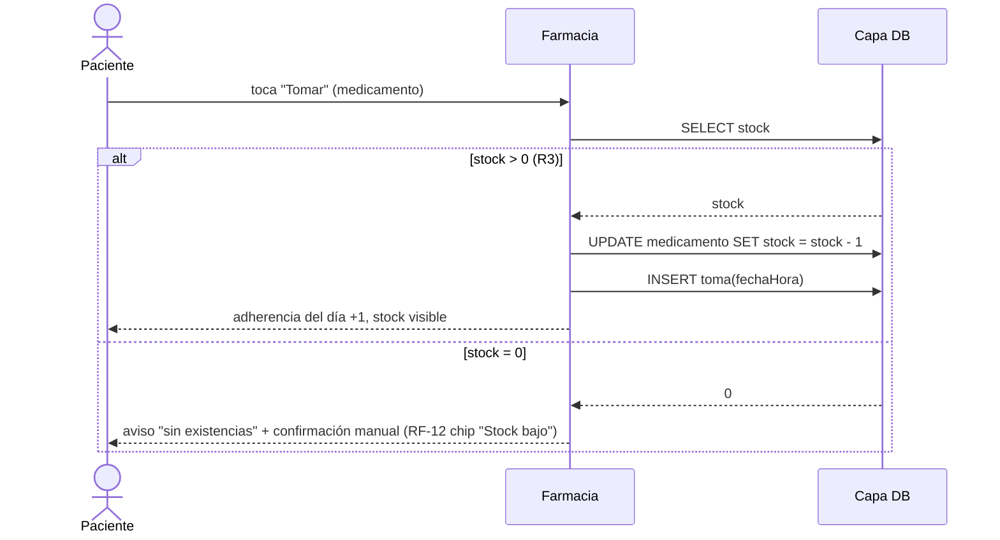

---

## 2.3 Diagrama de actividad — flujo integral de una consulta

**Mermaid**


**PlantUML (equivalente resumido)**
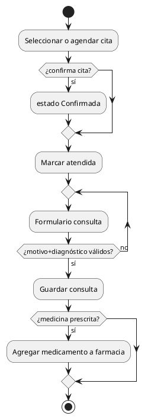

---

## 2.4 Diagrama de estados — Ciclo de vida de la Cita (R1)

**Mermaid**
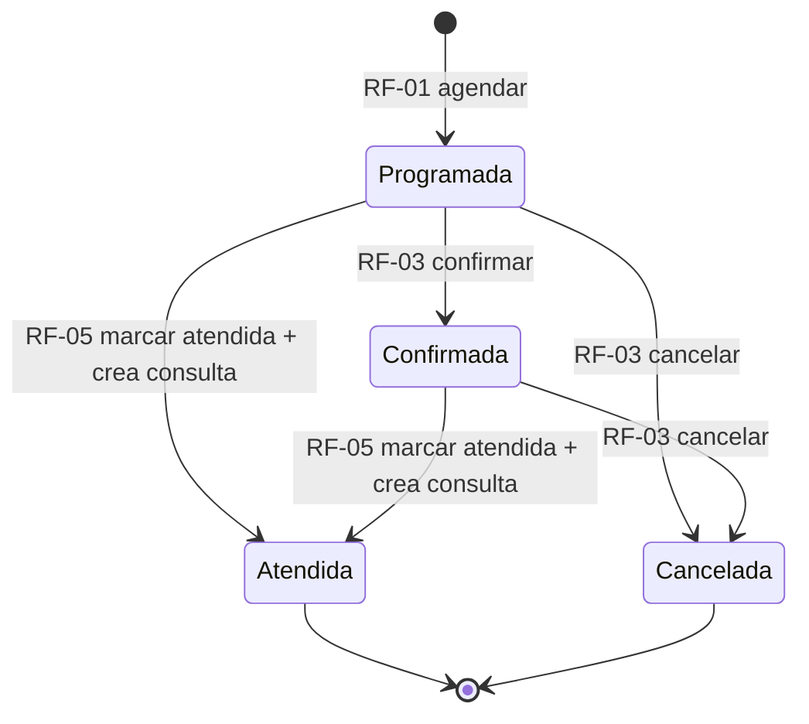

**PlantUML**
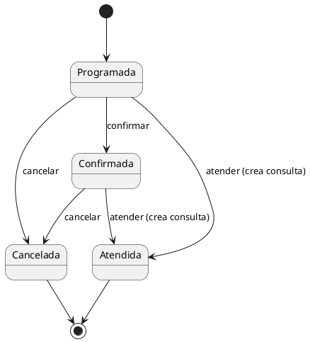

---

## 2.5 Diagrama de clases

Notas: la app instancia este modelo en el dispositivo (v3 del doc 03).
`consulta` y `cita` comparten `medicoId`; el vínculo cita→consulta es 1:1
única. Navegación y estados según R1.

**Mermaid**
```mermaid
classDiagram
  class Paciente {
    +id : string
    +nombre : string
    +generarRespaldo() JSON
  }
  class Medico {
    +id : string
    +nombre : string
    +consultorio : string
    +telefono : string
  }
  class Especialidad {
    +id : string
    +nombre : string
  }
  class Cita {
    +id : string
    +fechaHora : datetime
    +estado : EstadoCita
    +consultorio : string
    +validarTraslape() bool
    +transicionar(nuevoEstado) void
  }
  class Consulta {
    +id : string
    +fecha : date
    +motivo : string
    +diagnostico : string
    +indicaciones : string
    +observaciones : string
  }
  class Medicamento {
    +id : string
    +nombre : string
    +presentacion : string
    +dosis : string
    +frecuenciaHoras : int
    +stock : int
    +suspendido : bool
    +estaActivo() bool
    +descontarStock() void
  }
  class Toma {
    +id : string
    +fechaHora : datetime
    +confirmadaManual : bool
  }

  Especialidad "1" --> "0..*" Medico : clasifica
  Medico "1" --> "0..*" Cita : atiende
  Medico "1" --> "0..*" Consulta : registra
  Cita "0..1" --> "0..1" Consulta : deriva (1:1 única)
  Consulta "1" --> "0..*" Medicamento : prescribe
  Medicamento "1" --> "0..*" Toma : registra
```

**PlantUML**
```plantuml
@startuml
class Paciente { +id; +nombre; +generarRespaldo() }
class Medico { +id; +nombre; +consultorio; +telefono }
class Especialidad { +id; +nombre }
class Cita { +id; +fechaHora; +estado; +consultorio; +validarTraslape(); +transicionar() }
class Consulta { +id; +fecha; +motivo; +diagnostico; +indicaciones; +observaciones }
class Medicamento { +id; +nombre; +presentacion; +dosis; +stock; +suspendido; +estaActivo(); +descontarStock() }
class Toma { +id; +fechaHora; +confirmadaManual }

Especialidad "1" -- "0..*" Medico
Medico "1" -- "0..*" Cita
Medico "1" -- "0..*" Consulta
Cita "0..1" -- "0..1" Consulta : deriva 1:1
Consulta "1" -- "0..*" Medicamento : prescribe
Medicamento "1" -- "0..*" Toma
@enduml
```

---

## 2.6 Resumen de cobertura

| Diagrama | Cubre |
|---|---|
| Casos de uso | RF-01…RF-18 (todos los actores y relaciones include/extend) |
| Secuencias | S1 agendar/validar (RF-01/02/14) · S2 atender/diagnosticar (RF-05/06) · S3 toma/stock (RF-11/12/R3) |
| Actividad | Recorrido completo cita→consulta→farmacia |
| Estados | R1 ciclo de vida de cita |
| Clases | 7 entidades de doc 03 + responsabilidades |

---

## 2.7 Extensión v2 — Roles, perfiles, timeline y consentimiento (CU-12…CU-16)

Añadida el 25-10-2026 a partir de doc 01 §4-A (RF-19…RF-26):
§2.7-A casos de uso · §2.7-B tres secuencias nuevas · §2.7-C clases v2.

### 2.7-A Casos de uso v2 (Mermaid)

Solo el segmento v2; el segmento v1 está en §2.1.

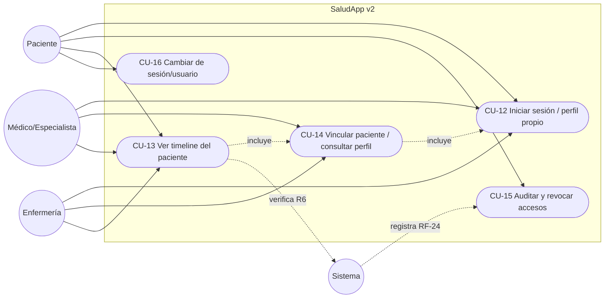

### PlantUML (equivalente)

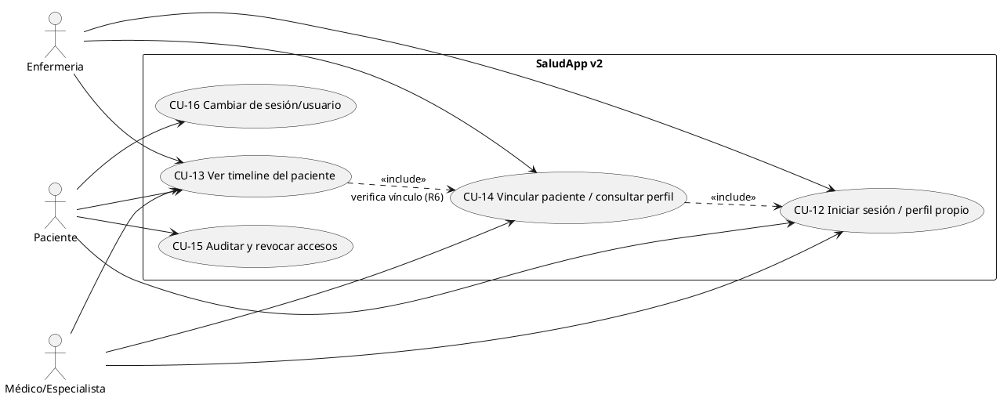

### Casos de uso ampliados v2 (los 3 principales)

**CU-12 Iniciar sesión / perfil propio (RF-19, RF-20)**
| | |
|---|---|
| Actor | Paciente · Médico/Especialista · Enfermería |
| Precondición | Al menos una cuenta creada en el dispositivo |
| Flujo principal | 1) Se abre la app en pantalla de sesión · 2) El usuario selecciona o ingresa su cuenta · 3) El sistema carga su `usuario` con rol · 4) Se renderiza el perfil propio (RF-20) y el Inicio adaptado al rol: paciente → Citas/Historial/Farmacia; médico/enfermería → Pacientes vinculados |
| Flujo alternativo | 1a) Cuenta nueva → alta guiada con rol, nombre y (staff) credencial/profesión |
| Postcondición | Sesión activa; los datos visibles son solo los del usuario y sus vínculos (RF-26) |

**CU-13 Ver timeline del paciente (RF-21, RF-22, RF-23, R6)**
| | |
|---|---|
| Actor | Paciente (su propio timeline) · Med/Enf (timeline de pacientes vinculados, lectura) |
| Precondición | Sesión activa; para el staff: vínculo en estado `Activo` (R6-1) |
| Flujo principal | 1) Abre "Perfil / Timeline" · 2) El sistema verifica el vínculo (staff) · 3) Consolida eventos: cita (programada/confirmada/atendida/cancelada), consulta (motivo, diagnóstico, indicaciones), alta/suspensión de medicamento, toma de dosis — cada uno con fecha-hora y tipo (RF-21, R7) · 4) Ordena cronológico inverso · 5) Si es staff, NO se muestran acciones de escritura (RF-23) y queda registrada la lectura en auditoría (RF-24) |
| Flujo alternativo | 2a) Sin vínculo `Activo` → pantalla "Sin acceso al perfil" (nada queda registrado como lectura) · 5a) Filtros por tipo (RF-22) o rango de fechas |
| Postcondición | Timeline mostrado; si el lector es staff: 1 fila en `acceso_auditoria` |

**CU-14 Vincular paciente / consultar perfil (RF-23)**
| | |
|---|---|
| Actor | Paciente (otorga) · Med/Enf (queda vinculado) |
| Precondición | Cuenta del profesional existente en el dispositivo; paciente con sesión activa |
| Flujo principal | 1) Paciente entra a "Accesos a mi perfil" · 2) Elige profesional (médico o enfermería) · 3) Concede el permiso (consentimiento explícito, R6-1) → el sistema crea `vinculo_personal` estado `Activo` con fecha · 4) El profesional queda listo para usar CU-13 sobre ese paciente |
| Flujo alternativo | 3a) Ya existe vínculo `Activo` con ese profesional → aviso, no se duplica |
| Postcondición | Vínculo persistido y auditable; el paciente puede revocarlo después (RF-25) |

**CU-15 Auditar y revocar (compacto, RF-24, RF-25)** — El paciente ve la lista de accesos a su perfil (quién, cuándo, acción) y puede revocar un vínculo: `Activo → Revocado` con fecha; el profesional pierde el acceso de inmediato (próximo CU-13 fallará la verificación R6); el historial de accesos se conserva (R7).

**CU-16 Cambiar de sesión (compacto, RF-26)** — Cerrar sesión y abrir otra cuenta: la app re-renderiza con los datos del nuevo usuario; ningún dato de un paciente aparece bajo la sesión de otro. Necesario cuando un cuidador usa el mismo teléfono o cuando un profesional atiende varios pacientes.

### 2.7-B Secuencias v2 (3 flujos donde el sistema decide)

**S4 — Vincular profesional y consentimiento (RF-23, R6-1)**

Mermaid:
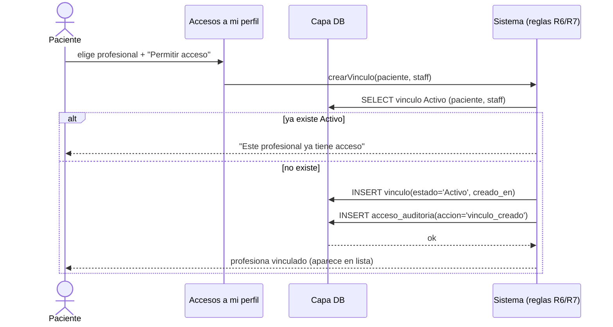

PlantUML:
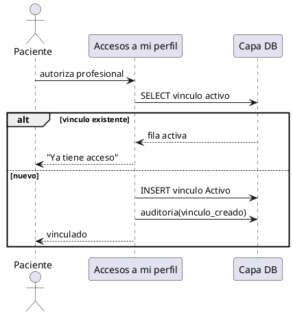

**S5 — Profesional consulta timeline (verificación de permiso + auditoría, RF-23/24, R6)**

Mermaid:
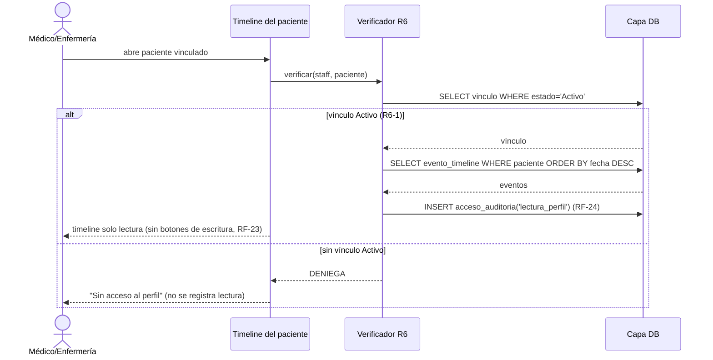

PlantUML:
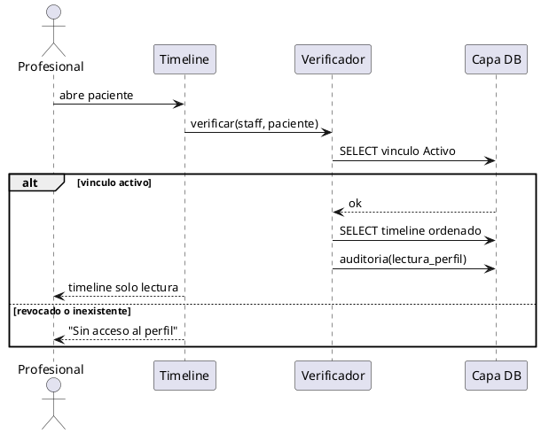

**S6 — Revocar consentimiento (RF-25, R7)**

Mermaid:
```mermaid
sequenceDiagram
  actor P as Paciente
  participant UI as Accesos a mi perfil
  participant DB as Capa DB
  P->>UI: "Revocar acceso" (profesional X)
  UI->>UI: confirmación explícita
  UI->>DB: UPDATE vinculo SET estado='Revocado', revocado_en
  UI->>DB: INSERT acceso_auditoria('consentimiento_revocado')
  DB-->>UI: ok
  UI-->>P: profesional pasa a "sin acceso"; su historial de accesos se conserva (R7)
  note over UI: el próximo intento del profesional (S5) recibirá DENIEGA
```

PlantUML:
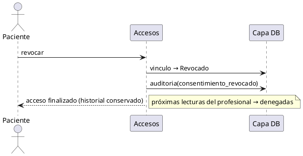

### 2.7-C Clases v2 (fragmento, Mermaid + PlantUML)

Se añaden 3 clases al modelo de §2.5. El timeline NO es una clase con
estado propio: es una consulta derivada (VISTA `evento_timeline` en doc 03
§3.6) sobre `cita`/`consulta`/`medicamento`/`toma`.

**Mermaid (fragmento v2)**
```mermaid
classDiagram
  class Usuario {
    +id : string
    +nombre : string
    +rol : Rol (paciente|medico|enfermeria)
    +credencial : string (staff)
    +sesiónActiva() bool
  }
  class VinculoPersonal {
    +id : string
    +estado : EstadoVinculo (Activo|Revocado)
    +creadoEn : datetime
    +revocadoEn : datetime
    +permiteLectura() bool
  }
  class AccesoAuditoria {
    +id : string
    +fechaHora : datetime
    +accion : Accion (lectura_perfil|vinculo_creado|consentimiento_revocado)
  }

  Usuario "0..1" --> "0..1" Medico : cuenta del directorio v1
  Usuario "1" --> "0..*" VinculoPersonal : concede como paciente
  Usuario "1" --> "0..*" VinculoPersonal : recibe como staff
  VinculoPersonal "1" --> "0..*" AccesoAuditoria : registra
```

**PlantUML (fragmento v2)**
```plantuml
@startuml
class Usuario { +id; +nombre; +rol; +credencial; +sesiónActiva() }
class VinculoPersonal { +id; +estado; +creadoEn; +revocadoEn; +permiteLectura() }
class AccesoAuditoria { +id; +fechaHora; +accion }
Usuario "0..1" -- "0..1" Medico : cuenta de un registro del directorio
 Usuario "1" -- "0..*" VinculoPersonal : paciente (concede)
Usuario "1" -- "0..*" VinculoPersonal : staff (recibe)
VinculoPersonal "1" -- "0..*" AccesoAuditoria : registra
@enduml
```

### Cobertura v2

| Diagrama | Cubre |
|---|---|
| Casos de uso (§2.7-A) | RF-19…RF-26 + relaciones include y verificación R6 |
| Secuencias | S4 vincular/consentir (RF-23, R6-1) · S5 lectura con permiso+auditoría (RF-23/24, R6) · S6 revocación (RF-25, R7) |
| Clases (§2.7-C) | `usuario`, `vinculo_personal`, `acceso_auditoria` + timeline como vista derivada |

---

## 2.8 Extensión v2.1 — Dispositivos vestibles y mediciones (CU-17…CU-19)

Añadida el 25-10-2026 a partir de doc 01 §4-B (RF-27…RF-31, R8).
Entidades en doc 03 §3.7 (`dispositivo`, `medicion`).

### 2.8-A Casos de uso (Mermaid)

```mermaid
flowchart LR
  pac((Paciente))
  dev((Reloj inteligente / wearable))
  sys((Sistema))
  subgraph SaludApp v2.1
    cu17([CU-17 Gestionar dispositivos])
    cu18([CU-18 Capturar / sincronizar mediciones])
    cu19([CU-19 Consultar mediciones y tendencias])
  end
  pac --> cu17 & cu19
  dev --> cu18
  sys --> cu18
  cu18 -.incluye.-> cu19
  cu17 -.incluye.-> cu18
```

### PlantUML (equivalente)

```plantuml
@startuml
left to right direction
actor Paciente
actor "Reloj inteligente\n(wearable)" as Dev
actor Sistema
rectangle "SaludApp v2.1" {
  usecase "CU-17 Gestionar dispositivos" as CU17
  usecase "CU-18 Capturar / sincronizar mediciones" as CU18
  usecase "CU-19 Consultar mediciones y tendencias" as CU19
}
Paciente --> CU17
Paciente --> CU19
Dev --> CU18
Sistema --> CU18
CU18 ..> CU19 : <<include>>
CU17 ..> CU18 : <<include>>
@enduml
```

### Casos de uso ampliados

**CU-17 Gestionar dispositivos (RF-27)**
| | |
|---|---|
| Actor | Paciente |
| Precondición | Sesión activa como `paciente` |
| Flujo principal | 1) Abre "Mis dispositivos" · 2) Toca vincular · 3) Elige canal (Health Connect / BLE / manual) y tipo (reloj, anillo, glucómetro…) y nombre · 4) El sistema crea `dispositivo` estado `Activo` |
| Flujo alternativo | 3a) El canal niega permisos → aviso; el dispositivo queda disponible como ingreso manual · 6a) Desvincular: `Activo → Desconectado/Retirado`; el historial de mediciones se conserva (R7) |
| Postcondición | La medicion del dispositivo crece ligada a `dispositivo_id`; ninguna medición previa se pierde |

**CU-18 Capturar / sincronizar mediciones (RF-28, RF-31)**
| | |
|---|---|
| Actor | Dispositivo (origen) · Sistema (sincroniza) · Paciente (manual) |
| Precondición | Dispositivo `Activo` o ingreso manual; sesión `paciente` |
| Flujo principal | 1) Al abrir la app (o registro manual) el sistema pide nuevo datos al canal · 2) Recibe lecturas: tipo + valor + unidad + fecha-hora · 3) Descarta duplicados (único: dispositivo+tipo+fecha-hora) · 4) INSERT en `medicion` (paciente_id de la sesión) · 5) El timeline (RF-30) ya las exibe vía vista, y la pantalla Mediciones se recarga |
| Flujo alternativo | 2a) Sin datos nuevos → termina sin registrar nada (RF-31) · 2b) Valor inválido (negativo/absurdo) → se rechaza con aviso |
| Postcondición | `medicion` persistida + evento en timeline; sin duplicados |

**CU-19 Consultar mediciones y tendencias (RF-29, RF-30)**
| | |
|---|---|
| Actor | Paciente (suyo) · Staff vinculado (lectura, R6-1 vía CU-13/S5) |
| Flujo principal | 1) Abre "Mediciones" · 2) Elige tipo (frecuencia cardíaca, glucosa…) · 3) Ve última lectura destacada + tendencia 7/30 días + lista · 4) Valores fuera de rango de referencia quedan marcados (R8 — informativa, no diagnóstico) |
| Postcondición | Si el lector es staff: el acceso ya fue auditado (S5) |

### 2.8-B Secuencias v2.1 (2 flujos nuevos)

**S7 — Vincular dispositivo y primera sincronización (RF-27, RF-31)**

Mermaid:
```mermaid
sequenceDiagram
  actor P as Paciente
  participant UI as Mis dispositivos
  participant CAN as Canal (Health Connect / BLE / manual)
  participant DB as Capa DB
  P->>UI: "Vincular reloj"
  UI->>CAN: solicitar permiso
  alt permiso concedido
    CAN-->>UI: ok
    UI->>DB: INSERT dispositivo(Activo, canal)
    UI->>CAN: pedir lecturas nuevas
    CAN-->>UI: lecturas (tipo, valor, unidad, fechaHora)
    UI->>DB: INSERT medicion (descarta duplicados)
    UI-->>P: dispositivo activo + mediciones visibles
  else permiso denegado
    CAN-->>UI: rechazo
    UI-->>P: dispositivo queda como ingreso manual
  end
```

PlantUML:
```plantuml
@startuml
actor Paciente
participant "Mis dispositivos" as UI
participant "Canal (HC/BLE/manual)" as CAN
participant "Capa DB" as DB
Paciente -> UI : vincular reloj
UI -> CAN : pedir permiso
alt concedido
  CAN --> UI : ok
  UI -> DB : INSERT dispositivo Activo
  UI -> CAN : pedir lecturas nuevas
  CAN --> UI : lecturas
  UI -> DB : INSERT medicion deduplicada
  UI --> Paciente : activo + mediciones
else denegado
  UI --> Paciente : modo ingreso manual
end
@enduml
```

**S8 — Capturar lectura y marcar fuera de rango (RF-28/29, R8)**

Mermaid:
```mermaid
sequenceDiagram
  participant CAN as Canal (Health Connect / BLE / manual)
  participant UI as Mediciones
  participant RNG as Reglas (R8)
  participant DB as Capa DB
  CAN->>UI: nueva lectura (SpO2 91%)
  UI->>DB: ¿existe dispositivo+tipo+fechaHora?
  alt ya existe
    DB-->>UI: sí → descarta duplicado (RF-28)
  else nueva
    UI->>DB: INSERT medicion
    UI->>RNG: comparar con rango de referencia del tipo
    RNG-->>UI: "fuera de rango" (informativa — NO diagnóstico)
    UI-->>P: medición listada + marcada; evento ya en timeline (RF-30)
  end
```

PlantUML:
```plantuml
@startuml
participant "Canal" as CAN
participant "Mediciones" as UI
participant "R8" as RNG
participant "Capa DB" as DB
CAN -> UI : nueva lectura
UI -> DB : ¿existe ya (dispositivo, tipo, fechaHora)?
alt existente
  DB --> UI : descartar
else nueva
  UI -> DB : INSERT medicion
  UI -> RNG : comparar rango de referencia
  RNG --> UI : fuera de rango (informativo)
  UI --> UI : timeline lo exhibe (RF-30)
end
@enduml
```

### 2.8-C Clases v2.1 (fragmento)

Timeline NO se altera como consulta: `medicion` entra a la VISTA
`evento_timeline` (doc 03 §3.7) con tipo `medicion`.

**Mermaid (fragmento)**
```mermaid
classDiagram
  class Dispositivo {
    +id : string
    +nombre : string
    +tipo : Tipo (reloj|anillo|banda|glucometro|tensiómetro|bascula)
    +canal : Canal (health_connect|ble|manual)
    +estado : EstadoDisp (Activo|Retirado)
    +vinculadoEn : datetime
  }
  class Medicion {
    +id : string
    +tipo : TipoMed (fc|spo2|pasos|sueno|glucosa|p_sistolica|p_diastolica|temperatura|peso|calorias)
    +valor : float
    +unidad : string
    +fechaHora : datetime
    +esManual : bool
    +fueraDeRango(ref) bool
  }
  Usuario "1" --> "0..*" Dispositivo : posee (paciente)
  Dispositivo "1" --> "0..*" Medicion : registra
  Usuario "1" --> "0..*" Medicion : paciente_id (origen manual o del device)
```

**PlantUML (fragmento)**
```plantuml
@startuml
class Dispositivo { +id; +nombre; +tipo; +canal; +estado; +vinculadoEn }
class Medicion { +id; +tipo; +valor; +unidad; +fechaHora; +esManual; +fueraDeRango(ref) }
Usuario "1" -- "0..*" Dispositivo : posee como paciente
Dispositivo "1" -- "0..*" Medicion : registra
Usuario "1" -- "0..*" Medicion : dueño del hecho
@enduml
```

### Cobertura v2.1

| Diagrama | Cubre |
|---|---|
| Casos de uso (§2.8-A) | RF-27…RF-31 + include entre dispositivos y mediciones |
| Secuencias | S7 vincular/primera sync (RF-27/31) · S8 captura/dedup/fuera-de-rango (RF-28/29, R8) |
| Clases (§2.8-C) | `dispositivo`, `medicion` + medicion-evento en vista timeline |
