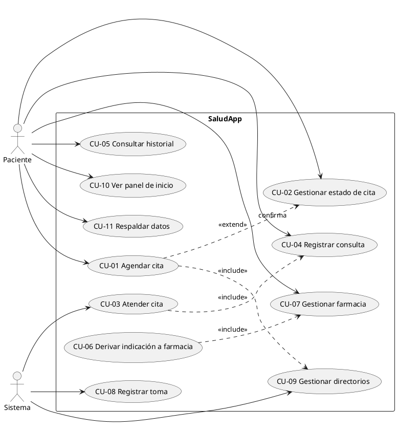
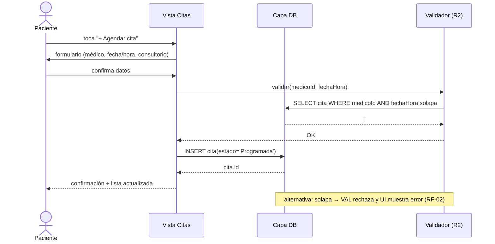
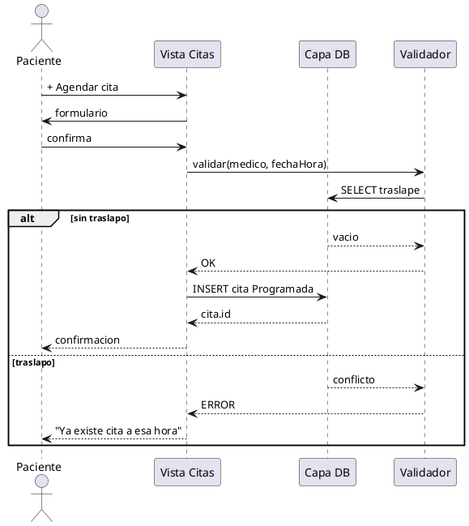
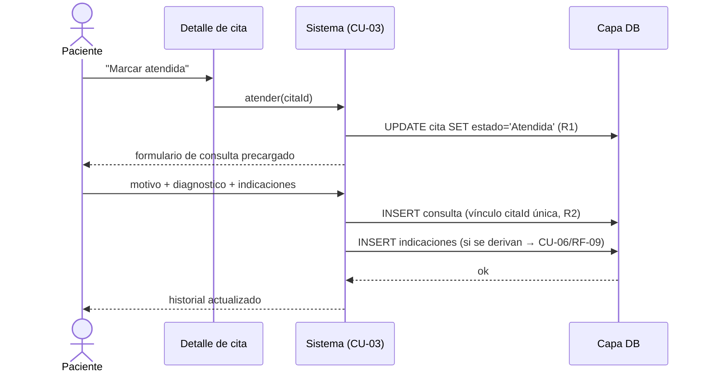
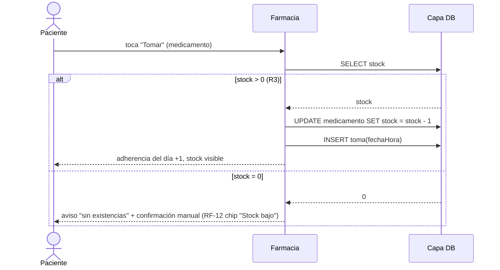
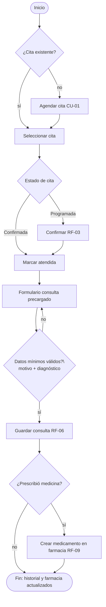
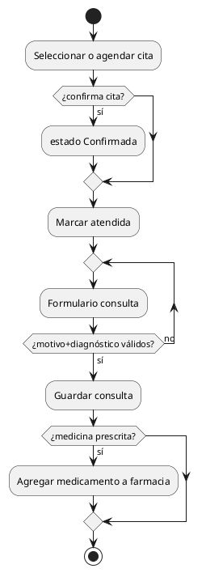
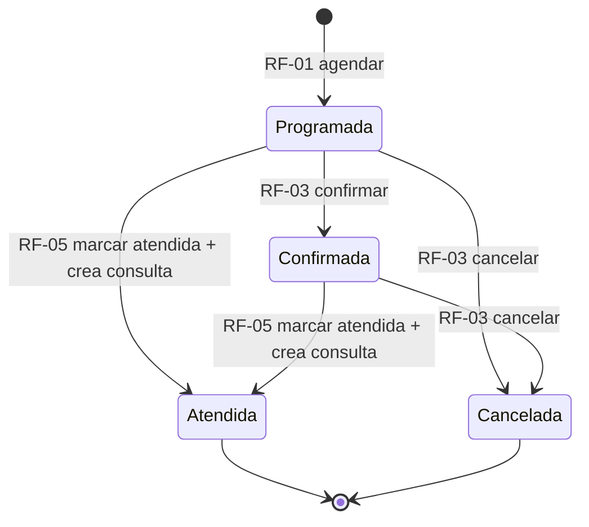
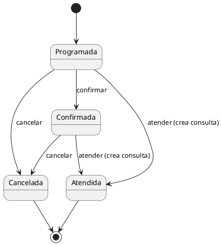

# 2. Modelo UML — casos de uso, secuencia, actividad, estados y clases

Cada diagrama se entrega en **dos formatos** (misma semántica):
**Mermaid** (renderiza en GitHub/VS Code/Obsidian sin instalar nada) y
**PlantUML** (estándar académico; renderiza en plantuml.com o con la
extensión de VS Code).

Actores definidos en doc 01 §3. Requerimientos trazados en doc 01 §9.

---

## 2.1 Diagrama de casos de uso

### Mermaid


### PlantUML



### Casos de uso ampliados (los 3 principales)

**CU-01 Agendar cita (RF-01, RF-02, RF-14)**
| | |
|---|---|
| Actor | Paciente |
| Precondición | Saludo en Inicio; botón "Agendar cita" disponible |
| Flujo principal | 1) Toca **+ Agendar cita** · 2) Elige médico (existente o nuevo → CU-09) · 3) Elige especialidad · 4) Elige fecha/hora · 5) Ingresa consultorio · 6) Confirma · 7) El sistema valida traslape (RF-02) y guarda con estado `Programada` · 8) Inicio muestra la cita como "Próxima cita" |
| Flujo alternativo | 7a) Traslape detectado → error "Ya hay una cita con ese médico a esa hora" → vuelve a paso 4 |
| Postcondición | Cita persistida en `cita` (estado `Programada`) |

**CU-03 Atender cita (RF-05, RF-06)**
| | |
|---|---|
| Actor | Paciente (dispara), Sistema (crea consulta) |
| Precondición | Cita en `Programada` o `Confirmada` |
| Flujo principal | 1) Abre detalle de cita · 2) Toca **Marcar atendida** · 3) Sistema transiciona cita a `Atendida` (R1) · 4) Sistema abre formulario de consulta precargado (médico/especialidad/fecha) · 5) Paciente escribe motivo, **diagnóstico** e **indicaciones** · 6) Guarda (RF-06) → consulta queda vinculada 1:1 a la cita (R2) |
| Postcondición | `consulta` creada; cita `Atendida`; historial actualizado |

**CU-08 Registrar toma (RF-11, R3)**
| | |
|---|---|
| Actor | Paciente |
| Flujo principal | 1) En Farmacia toca **Tomar** en un medicamento activo · 2) Sistema valida stock > 0 (R3) · 3) Descuenta 1 a stock · 4) Registra `toma` con fecha-hora · 5) Actualiza adherencia del día |
| Alternativo | 2a) Stock 0 → aviso "sin existencias" + opción "sí tomar (marcado manual)" |

---

## 2.2 Diagramas de secuencia (3 flujos críticos)

### S1 — Agendar cita con validación de traslape

**Mermaid**


**PlantUML**


### S2 — Atender cita y registrar consulta (diagnóstico + indicaciones)

**Mermaid**


### S3 — Registrar toma y descontar stock

**Mermaid**


---

## 2.3 Diagrama de actividad — flujo integral de una consulta

**Mermaid**


**PlantUML (equivalente resumido)**


---

## 2.4 Diagrama de estados — Ciclo de vida de la Cita (R1)

**Mermaid**


**PlantUML**


---

## 2.5 Diagrama de clases

Notas: la app instancia este modelo en el dispositivo (v3 del doc 03).
`consulta` y `cita` comparten `medicoId`; el vínculo cita→consulta es 1:1
única. Navegación y estados según R1.

**Mermaid**
```mermaid
classDiagram
  class Paciente {
    +id : string
    +nombre : string
    +generarRespaldo() JSON
  }
  class Medico {
    +id : string
    +nombre : string
    +consultorio : string
    +telefono : string
  }
  class Especialidad {
    +id : string
    +nombre : string
  }
  class Cita {
    +id : string
    +fechaHora : datetime
    +estado : EstadoCita
    +consultorio : string
    +validarTraslape() bool
    +transicionar(nuevoEstado) void
  }
  class Consulta {
    +id : string
    +fecha : date
    +motivo : string
    +diagnostico : string
    +indicaciones : string
    +observaciones : string
  }
  class Medicamento {
    +id : string
    +nombre : string
    +presentacion : string
    +dosis : string
    +frecuenciaHoras : int
    +stock : int
    +suspendido : bool
    +estaActivo() bool
    +descontarStock() void
  }
  class Toma {
    +id : string
    +fechaHora : datetime
    +confirmadaManual : bool
  }

  Especialidad "1" --> "0..*" Medico : clasifica
  Medico "1" --> "0..*" Cita : atiende
  Medico "1" --> "0..*" Consulta : registra
  Cita "0..1" --> "0..1" Consulta : deriva (1:1 única)
  Consulta "1" --> "0..*" Medicamento : prescribe
  Medicamento "1" --> "0..*" Toma : registra
```

**PlantUML**
```plantuml
@startuml
class Paciente { +id; +nombre; +generarRespaldo() }
class Medico { +id; +nombre; +consultorio; +telefono }
class Especialidad { +id; +nombre }
class Cita { +id; +fechaHora; +estado; +consultorio; +validarTraslape(); +transicionar() }
class Consulta { +id; +fecha; +motivo; +diagnostico; +indicaciones; +observaciones }
class Medicamento { +id; +nombre; +presentacion; +dosis; +stock; +suspendido; +estaActivo(); +descontarStock() }
class Toma { +id; +fechaHora; +confirmadaManual }

Especialidad "1" -- "0..*" Medico
Medico "1" -- "0..*" Cita
Medico "1" -- "0..*" Consulta
Cita "0..1" -- "0..1" Consulta : deriva 1:1
Consulta "1" -- "0..*" Medicamento : prescribe
Medicamento "1" -- "0..*" Toma
@enduml
```

---

## 2.6 Resumen de cobertura

| Diagrama | Cubre |
|---|---|
| Casos de uso | RF-01…RF-18 (todos los actores y relaciones include/extend) |
| Secuencias | S1 agendar/validar (RF-01/02/14) · S2 atender/diagnosticar (RF-05/06) · S3 toma/stock (RF-11/12/R3) |
| Actividad | Recorrido completo cita→consulta→farmacia |
| Estados | R1 ciclo de vida de cita |
| Clases | 7 entidades de doc 03 + responsabilidades |
