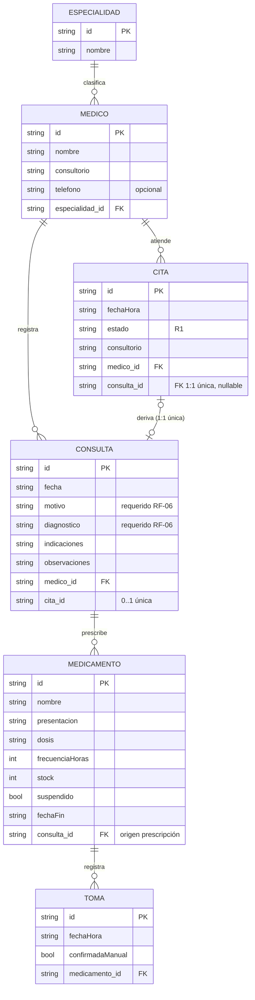
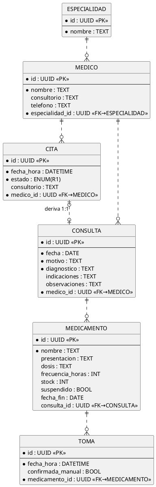
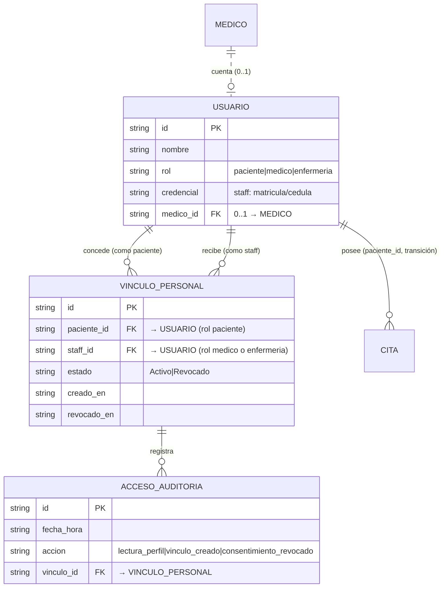
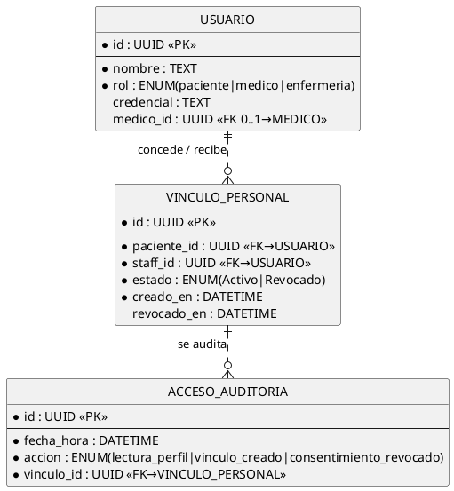
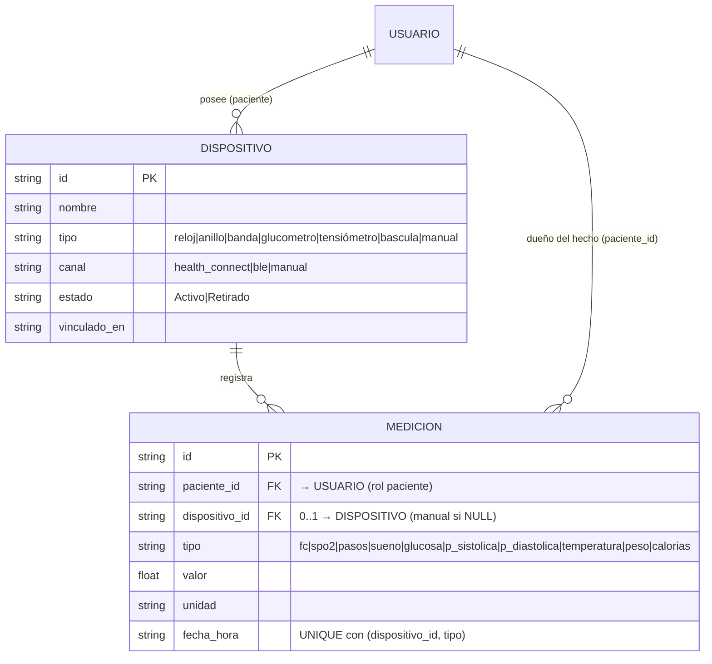

# 3. Modelo de datos — E-R, relacional y normalización

Diseño normalizado **v3 + extensión v4 (25-10-2026)**. Soporta todos los RF
del doc 01 (v1: RF-01…RF-18; v2: RF-19…RF-26 sobre las entidades de §3.6)
y las entidades del diagrama de clases del doc 02 §2.5/§2.7-C. La app lo
implementa sobre la capa `DB` (persistencia local); el esquema es el mismo
que usaría un SQLite/PostgreSQL real si se migrara a backend.

---

## 3.1 Modelo Entidad–Relación (E-R)

Cardinalidades_(leer _: la relación deriva se lee "una cita deriva a una consulta (0..1 ambos lados; única)")_.

### Mermaid (erDiagram)



### PlantUML (notación tipo Chen con atributos)



### Diagrama E-R clásico (Chen) — descripción de símbolos

```
[PACIENTE-IMPLÍCITO]          (el paciente es el usuario de la app; no es tabla)
        |
      (opera)
        |
        ▼
   [CITA] ——N———1——⟨atiende⟩——1—— [MÉDICO] ——N——1——⟨clasifica⟩—— [ESPECIALIDAD]
     |                              |
   ⟨deriva⟩ 1:1 única             ⟨registra⟩ 1:N
     |                              |
     ▼                              ▼
  [CONSULTA] ————⟨prescribe⟩ 1:N————→ [MEDICAMENTO]
                                          |
                                       ⟨registra⟩ 1:N
                                          ▼
                                       [TOMA]
```
Leyenda: `[rect]` entidad · `⟨rombo⟩` relación · `1/N` cardinalidad.

---

## 3.2 Modelo relacional (esquema v3 + DDL SQLite)

Relaciones: `especialidad(id, nombre)` · `medico(id, nombre, consultorio,
telefono, especialidad_id→especialidad)` · `cita(id, fecha_hora, estado,
consultorio, medico_id→medico)` · `consulta(id, fecha, motivo, diagnostico,
indicaciones, observaciones, medico_id→medico, cita_id 0..1 UNIQUE→cita)` ·
`medicamento(id, nombre, presentacion, dosis, frecuencia_horas, stock,
suspendido, fecha_fin, consulta_id→consulta)` · `toma(id, fecha_hora,
confirmada_manual, medicamento_id→medicamento)`.

```sql
-- ============ SaludApp esquema v3 (SQLite) ============
CREATE TABLE especialidad (
  id TEXT PRIMARY KEY,                       -- UUID
  nombre TEXT NOT NULL UNIQUE
);

CREATE TABLE medico (
  id TEXT PRIMARY KEY,
  nombre TEXT NOT NULL,
  consultorio TEXT,
  telefono TEXT,
  especialidad_id TEXT NOT NULL REFERENCES especialidad(id)
);

CREATE TABLE cita (
  id TEXT PRIMARY KEY,
  fecha_hora TEXT NOT NULL,                  -- ISO 8601
  estado TEXT NOT NULL DEFAULT 'Programada'
      CHECK (estado IN ('Programada','Confirmada','Atendida','Cancelada')),
  consultorio TEXT,
  medico_id TEXT NOT NULL REFERENCES medico(id)
);

CREATE TABLE consulta (
  id TEXT PRIMARY KEY,
  fecha TEXT NOT NULL,
  motivo TEXT NOT NULL,
  diagnostico TEXT NOT NULL,                 -- RF-06 obligatorio
  indicaciones TEXT,
  observaciones TEXT,
  medico_id TEXT NOT NULL REFERENCES medico(id),
  cita_id TEXT REFERENCES cita(id)  -- vínculo 1:1 (R2)
);

CREATE UNIQUE INDEX ux_consulta_cita ON consulta(cita_id) WHERE cita_id IS NOT NULL;

CREATE TABLE medicamento (
  id TEXT PRIMARY KEY,
  nombre TEXT NOT NULL,
  presentacion TEXT,
  dosis TEXT,
  frecuencia_horas INTEGER,
  stock INTEGER NOT NULL DEFAULT 0 CHECK (stock >= 0),   -- R3
  suspendido INTEGER NOT NULL DEFAULT 0,                 -- 0/1
  fecha_fin TEXT,
  consulta_id TEXT REFERENCES consulta(id)              -- origen prescripción
);

CREATE TABLE toma (
  id TEXT PRIMARY KEY,
  fecha_hora TEXT NOT NULL,
  confirmada_manual INTEGER NOT NULL DEFAULT 0,
  medicamento_id TEXT NOT NULL REFERENCES medicamento(id)
);

-- Índices de consulta frecuente
CREATE INDEX ix_cita_medico_fecha ON cita(medico_id, fecha_hora);        -- RF-02 traslapes
CREATE INDEX ix_cita_estado   ON cita(estado);
CREATE INDEX ix_consulta_fecha ON consulta(fecha DESC);
CREATE INDEX ix_toma_med      ON toma(medicamento_id, fecha_hora DESC);
CREATE INDEX ix_stock_bajo    ON medicamento(stock, suspendido);         -- RF-12
```

Restricciones de integridad más allá de las claves:
- `cita.estado` enum (CHECK) ⇒ R1 aplicable a nivel de esquema.
- `medicamento.stock ≥ 0` (CHECK) ⇒ R3.
- `consulta.cita_id` UNIQUE parcial ⇒ R2 (una cita apenas puede derivar una consulta).
- FKs con integridad referencial; borrado prohibido para entidades con historial (borrado real solo si no se referencia).

---

## 3.3 Normalización (proceso completo con el ejemplo real)

Partimos de una "hoja de registro" de papel llena por el recepcionista y la
normalizamos hasta 3FN.

### Forma no normalizada (FNN)

| campo |
|---|
| `hoja_consulta = { fecha, paciente, nombre_medico, especialidad, consultorio, motivo, diagnostico, indicaciones_texto, prescripciones_texto (lista repetida), tomas_texto (lista repetida) }` |

Ejemplo concreto de fila (con grupos repetidos):

| fecha | medico | especialidad | motivo | diagnostico | indicaciones | prescripciones | tomas |
|---|---|---|---|---|---|---|---|
| 2026-10-23 | Dr. Ramírez | Cardiología | control | hipertensión leve | descanso; comida blanda | `{ "losartán 50mg", "atorvastatina 20mg" }` | `{ "losartán 08:00", "losartán 20:00" }` |

### 1FN — atomicidad de campos

Todo valor es atómico; desaparecen los grupos repetidos/anidados.
**Violaciones de la FNN corregidas:** `prescripciones_texto` y `tomas_texto`
eras listas dentro de un campo.
→ 1FN: cada prescripción y cada toma viven en su propia fila/tabla.

```sql
-- 1FN (aún no óptimo)
CREATE TABLE reg_consulta (
  id TEXT PRIMARY KEY,
  fecha TEXT NOT NULL,
  nombre_medico TEXT NOT NULL,     -- aún lo anota el recepcionista
  especialidad TEXT NOT NULL,      -- aún redundante (→ 3FN la separa)
  consultorio TEXT,
  motivo TEXT, diagnostico TEXT, indicaciones TEXT
);
CREATE TABLE reg_prescripcion (
  consulta_id TEXT NOT NULL,
  nombre_medicamento TEXT NOT NULL,
  presentacion TEXT,               -- aún dentro de la fila (→ 2FN la extrae)
  dosis TEXT,
  PRIMARY KEY (consulta_id, nombre_medicamento)
);
CREATE TABLE reg_toma (
  prescripcion_id TEXT NOT NULL,
  fecha_hora TEXT NOT NULL
);
```
Cuestión: `reg_consulta` sigue repitiendo datos del médico en cada consulta.
Aún no hay problema de 1FN (los campos son atómicos), pero sí redundancia.

### 2FN — nada depende de parte de la clave (para claves compuestas)

En `reg_prescripcion` la clave natural era compuesta `(consulta_id, nombre_medicamento)`.
Dato no clave: `presentacion` (p. ej., "tableta 50mg") **depende solo de la
medicina**, no de la consulta → **dependencia parcial**.
Si una medicina se prescribe 500 veces, su presentación se repite 500 veces.

```sql
-- Antes (2FN violada, en la reg_prescripcion del bloque 1FN de arriba):
-- reg_prescripcion(consulta_id, nombre_medicamento, presentacion, dosis)
--                   PK ──────── tb PK ──────│
-- presentacion depende SOLO de nombre_medicamento → dependencia parcial
```
→ 2FN: extraer el catálogo en `medicamento(id, nombre, presentacion, …)` y
que la prescripción referencie `medicamento_id`.

### 3FN — nada depende transitivamente de la clave

En `reg_consulta` los campos no clave dependen unos de otros:
`nombre_medico → consultorio, especialidad_médica`.
`especialidad` depende de `nombre_medico`, no de la consulta →
**dependencia transitiva** (consulta_id → medico → consultorio/especialidad).
Cambio de consultorio se tendría que actualizar en TODAS las consultas del médico.

```sql
-- Antes (3FN violada): consulta_id → nombre_medico → consultorio, especialidad
-- reg_consulta(id, fecha, nombre_medico, consultorio, especialidad, motivo, diagnostico, …)
-- Después (3FN): cada hecho depende solo de su propia clave
```
→ 3FN: `medico(id, nombre, consultorio, especialidad_id)` y
`especialidad(id, nombre)` independientes; `consulta` solo lleva `medico_id`.

El estado de v3 (§3.2) es el resultado: cada tabla guarda hechos que
dependen de su clave, de la clave completa y únicamente de la clave.

### Resumen paso a paso

| Paso | Problema que resuelve | Cambio aplicado |
|---|---|---|
| FNN→1FN | Listas anidadas en un campo | 1 tabla/vschema por grupo repetido: prescripción y toma aparte |
| 1FN→2FN | Dependencia parcial de `(consulta_id, nombre_medicamento)` | Catálogo `medicamento` independiente; FK `medicamento_id` |
| 2FN→3FN | Dependencia transitiva consulta→médico→especialidad/consultorio | Tablas `medico` y `especialidad` propias con FKs |

¿Se llega a BCNF? Sí: en v3 todo determinante es clave candidata
(`id` en cada tabla; `especialidad.nombre` UNIQUE es clave candidata de
`especialidad`; `consulta.cita_id` UNIQUE parcial hace 1:1). No quedan
determinantes que no sean superclaves → **la v3 está en BCNF**, forma aún
más estricta que 3FN.

### Por qué NO vamos más allá (por qué denormalizar 0 cosas)

No se denormaliza nada: los conteos tipo "cuántas tomas hoy" o "próxima
cita" se derivan con consultas sobre `toma`/`cita` sin guardar duplicados —
son agregados, no atributos. Redundancia deliberada con propósito de
rendimiento no estaba justificada a < 500 registros (RNF-02).

---

## 3.4 Diccionario de datos (v3)

| Tabla | Atributo | Tipo | Restricción | Semántica |
|---|---|---|---|---|
| especialidad | id | TEXT UUID | PK | identificador |
| especialidad | nombre | TEXT | NOT NULL UNIQUE | p. ej. "Cardiología" |
| medico | id | TEXT UUID | PK | |
| medico | nombre | TEXT | NOT NULL | "Dr. Ramírez" |
| medico | consultorio | TEXT | opcional | |
| medico | telefono | TEXT | opcional | |
| medico | especialidad_id | TEXT | FK→especialidad NOT NULL | |
| cita | id | TEXT UUID | PK | |
| cita | fecha_hora | TEXT ISO 8601 | NOT NULL | |
| cita | estado | TEXT | NOT NULL DEFAULT 'Programada' CHECK enum R1 | ciclo de vida |
| cita | consultorio | TEXT | opcional (puede heredar del médico) | |
| cita | medico_id | TEXT | FK→medico NOT NULL | |
| consulta | id | TEXT UUID | PK | |
| consulta | fecha | TEXT | NOT NULL | |
| consulta | motivo | TEXT | NOT NULL | porqué va |
| consulta | diagnostico | TEXT | NOT NULL (RF-06) | diagnóstico médico |
| consulta | indicaciones | TEXT | opcional (tratamiento) | |
| consulta | observaciones | TEXT | opcional | notas/signos |
| consulta | medico_id | TEXT | FK→medico NOT NULL | |
| consulta | cita_id | TEXT | FK→cita, UNIQUE parcial | R2 1:1 |
| medicamento | id | TEXT UUID | PK | |
| medicamento | nombre | TEXT | NOT NULL | |
| medicamento | presentacion | TEXT | opcional | "tableta 50mg" |
| medicamento | dosis | TEXT | opcional | "1 tableta" |
| medicamento | frecuencia_horas | INTEGER | opcional ≥ 1 | periodicidad |
| medicamento | stock | INTEGER | NOT NULL ≥ 0 (R3) | cant. restante |
| medicamento | suspendido | INTEGER 0/1 | NOT NULL default 0 | fin de tratamiento |
| medicamento | fecha_fin | TEXT | opcional | fin previsto (R4) |
| medicamento | consulta_id | TEXT | FK→consulta | origen del prescribe |
| toma | id | TEXT UUID | PK | |
| toma | fecha_hora | TEXT ISO 8601 | NOT NULL | cuando se tomó |
| toma | confirmada_manual | INTEGER 0/1 | NOT NULL default 0 | caso stock 0 con permiso |
| toma | medicamento_id | TEXT | FK→medicamento NOT NULL | |

## 3.5 Consultas típicas (muestreo para verificación RF)

```sql
-- RF-02 traslape: citas del mismo médico que tocan la franja
SELECT id FROM cita
WHERE medico_id = :m
  AND estado <> 'Cancelada'
  AND fecha_hora BETWEEN :inicio AND :fin;

-- RF-07 historial cronológico inverso
SELECT * FROM consulta ORDER BY fecha DESC, id DESC;

-- RF-11 adherencia del día de un medicamento
SELECT COUNT(*) FROM toma
WHERE medicamento_id = :med AND fecha_hora LIKE :dia || '%';

-- RF-12 stock bajo (activos con ≤ 2)
SELECT * FROM medicamento WHERE suspendido = 0 AND stock <= 2;
```

---

## 3.6 Extensión v2 — esquema v4: usuarios, vínculos, auditoría y timeline

Añadida el 25-10-2026 para RF-19…RF-26 y R6/R7 (doc 01 §4-A/§7-bis).
Las 7 tablas del esquema v3 (§3.2) NO cambian de forma: v4 las **posee**
a través de `paciente_id` (transición) y les añade la capa de cuentas,
consentimientos y auditoría.

### 3.6-a E-R v2 (fragmento, Mermaid + PlantUML)

**Mermaid**


**PlantUML**


**Timeline (relación derivada, no tabla):** los eventos del perfil del
paciente provienen de `cita`, `consulta`, `medicamento` y `toma` — se
consolidan en la **VISTA** `evento_timeline` (§3.6-b). Ningún hecho se
duplica: la vista es siempre la unión de las tablas primarias (3FN).

### 3.6-b DDL v4 (SQLite, complementa el de §3.2)

```sql
-- ============ SaludApp esquema v4 — añade la capa multi-rol ============
-- (se ejecuta DESPUÉS del DDL v3 de §3.2)

CREATE TABLE usuario (
  id TEXT PRIMARY KEY,
  nombre TEXT NOT NULL,                      -- perfil propio RF-20
  rol TEXT NOT NULL
      CHECK (rol IN ('paciente','medico','enfermeria')),   -- R6 enum
  contacto TEXT,                             -- teléfono/correo opcional
  credencial TEXT,                           -- matrícula/cédula (medico/enfermeria)
  medico_id TEXT REFERENCES medico(id)       -- 0..1: cuenta de médico ⇔
);                                           -- registro del directorio v1
-- una cuenta de médico se liga a UN registro del directorio (0..1 los lados)
CREATE UNIQUE INDEX ux_usuario_medico
  ON usuario(medico_id) WHERE medico_id IS NOT NULL;

CREATE TABLE vinculo_personal (
  id TEXT PRIMARY KEY,
  paciente_id TEXT NOT NULL REFERENCES usuario(id),  -- el dueño del perfil
  staff_id TEXT NOT NULL REFERENCES usuario(id),     -- medico | enfermeria
  estado TEXT NOT NULL DEFAULT 'Activo'
      CHECK (estado IN ('Activo','Revocado')),      -- la revocación preserva la fila (R6/R7)
  creado_en TEXT NOT NULL,
  revocado_en TEXT
);
-- máximo UN vínculo Activo por par paciente-profesional: si el consentimiento
-- se re-otorga tras una revocación, se crea un vínculo NUEVO (la fila previa
-- queda en 'Revocado' como historial — R7)
CREATE UNIQUE INDEX ux_vinculo_activo
  ON vinculo_personal(paciente_id, staff_id) WHERE estado = 'Activo';

CREATE TABLE acceso_auditoria (
  id TEXT PRIMARY KEY,
  fecha_hora TEXT NOT NULL,
  accion TEXT NOT NULL
      CHECK (accion IN ('lectura_perfil','vinculo_creado','consentimiento_revocado')),
  vinculo_id TEXT NOT NULL REFERENCES vinculo_personal(id)
);

-- R6-2/R6-3 se aplican en la capa DB (SQLite no permite CHECK con subconsulta):
-- fila válida ⇔ rol(paciente_id)='paciente' ∧ rol(staff_id) IN ('medico','enfermeria')

-- Propiedad del paciente — transición del esquema v3 a v4:
-- NULL en v1 (paciente único) / NOT NULL cuando el modo multi-paciente de RF-26 esté activo
ALTER TABLE cita        ADD COLUMN paciente_id TEXT REFERENCES usuario(id);
ALTER TABLE consulta    ADD COLUMN paciente_id TEXT REFERENCES usuario(id);
ALTER TABLE medicamento ADD COLUMN paciente_id TEXT REFERENCES usuario(id);
ALTER TABLE medicamento ADD COLUMN creado_en TEXT;      -- fecha del evento de alta/suspensión (timeline)
-- toma la hereda vía medicamento; el paciente no se repite en toma (3FN)

CREATE INDEX ix_vinculo_staff  ON vinculo_personal(staff_id, estado); -- pacientes de un prof.
CREATE INDEX ix_acceso_orden   ON acceso_auditoria(vinculo_id, fecha_hora DESC);
CREATE INDEX ix_usu_paciente   ON usuario(rol);                      -- RF-19 menú por rol
```

Vista del timeline (RF-21) — la CONSULTA derivada que sustenta el perfil:

```sql
CREATE VIEW evento_timeline AS
SELECT c.id AS evento_id, 'cita' AS tipo, c.estado AS detalle,
       c.fecha_hora AS fecha_hora, c.paciente_id AS paciente_id
FROM cita c
UNION ALL
SELECT q.id, 'consulta', q.diagnostico, q.fecha, q.paciente_id
FROM consulta q
UNION ALL
SELECT m.id, 'medicamento', CASE m.suspendido
         WHEN 1 THEN 'suspendido' ELSE 'recetado' END,
       COALESCE(m.creado_en, m.fecha_fin), m.paciente_id
FROM medicamento m
UNION ALL
SELECT t.id, 'toma', m.nombre, t.fecha_hora, m.paciente_id
FROM toma t JOIN medicamento m ON m.id = t.medicamento_id;
```

Restricciones de integridad v2 adicionales:
- `usuario.rol` y `acceso_auditoria.accion` son enums (CHECK) ⇒ R6 aplicable a nivel de esquema.
- `vinculo_personal` jamás se borra: un vínculo revocado queda en `Revocado` (R7 — el historial se conserva); `ux_vinculo_activo` impide dos consentimientos activos simultáneos por par.
- `usuario.medico_id` UNIQUE parcial ⇒ una cuenta de médico es 0..1 con el directorio v1 (no se duplican profesionales al crear cuentas).
- Propiedad: con `paciente_id` activo (RF-26), cada hecho clínico pertenece a UN paciente; la capa DB lo fija en cada INSERT y el staff solo lee (R6-2).

### 3.6-c Normalización v2 (demostrada con los datos reales del dominio)

**FNN)** La hoja de consentimiento en papel mezcla todo en una línea:

| campo |
|---|
| `consentimiento = { paciente, profesional, credencial_profesional, especialidad_profesional, accesos_texto (lista: "lectura el 25/10, lectura el 26/10"), estado }` |

Ejemplo: `{ "Ana Torres", "Dr. Ramírez", "CED-4471", "Cardiología", { "lectura 25-10", "lectura 26-10" }, "Activo" }`.

**1FN** — `accesos_texto` es una lista dentro de un campo → los accesos
viven en su propia tabla `acceso_auditoria(id, fecha_hora, accion, vinculo_id)`,
una fila por acceso. El resto queda atómico.

**2FN** — en la hoja, `credencial` y `especialidad` del profesional
dependen solo de `profesional`, no del par `(paciente, profesional)` que
identifica el consentimiento → **dependencia parcial**:
(paciente, profesional) → credencial ❌ (la credencial no cambia con cada
paciente). → v4: `credencial` vive en `usuario` (perfila al profesional 1
vez) y `vinculo_personal` NO la repite. Un médico con 30 pacientes tiene
su credencial escrita UNA vez.

**3FN** — en `usuario(rol, credencial…)` no hay dependencias transitivas
(`credencial` depende de la clave). En el diseño FNN sí:
`consentimiento_id → profesional → credencial/especialidad` era
transitiva. Verificación adicional sobre v4: para un acceso,
`acceso_id → vinculo_id → paciente_id/staff_id` es navegación por FK, no
dependencia funcional dentro de una misma tabla → 3FN intacta.

**BCNF** — todo determinante de v4 es superclave: `usuario.id`,
el par único de `ux_usuario_medico` (`medico_id` → un `usuario`),
`vinculo_personal.id`, el par activo único de `ux_vinculo_activo`,
`acceso_auditoria.id`. No quedan determinantes que no sean claves
candidatas → **v4 está en BCNF**, como v3.

| Paso v2 | Problema que resuelve | Cambio aplicado |
|---|---|---|
| FNN→1FN | Lista de accesos dentro de la hoja de consentimiento | `acceso_auditoria` aparte, una fila por acceso |
| 1FN→2FN | Credencial del profesional repetida por cada vínculo (dependencia parcial del par) | `credencial` solo en `usuario`; el vínculo va por FK |
| 2FN→3FN | Hoja transitiva consentimiento→profesional→credencial/especialidad | Tablas `usuario` y `vinculo_personal` separadas |

### 3.6-d Diccionario de datos v2

| Tabla | Atributo | Tipo | Restricción | Semántica |
|---|---|---|---|---|
| usuario | id | TEXT UUID | PK | sesión de quien usa la app |
| usuario | nombre | TEXT | NOT NULL | nombre del perfil (RF-20) |
| usuario | rol | TEXT | NOT NULL CHECK enum | R6: `paciente`/`medico`/`enfermeria` |
| usuario | contacto | TEXT | opcional | teléfono/correo |
| usuario | credencial | TEXT | opcional | matrícula/cédula de staff |
| usuario | medico_id | TEXT | FK→medico, UNIQUE parcial | cuenta ⇔ directorio v1 |
| vinculo_personal | id | TEXT UUID | PK | un consentimiento |
| vinculo_personal | paciente_id | TEXT | FK→usuario(rol=paciente) NOT NULL | dueño del perfil |
| vinculo_personal | staff_id | TEXT | FK→usuario(rol=medico|enfermeria) NOT NULL | profesional autorizado |
| vinculo_personal | estado | TEXT | NOT NULL DEFAULT 'Activo' CHECK enum, UNIQUE parcial activo | R6-1; revocación conserva fila (R7) |
| vinculo_personal | creado_en / revocado_en | TEXT ISO | creado NOT NULL; revocado opcional | cuándo se otorgó/revocó |
| acceso_auditoria | id | TEXT UUID | PK | |
| acceso_auditoria | fecha_hora | TEXT ISO 8601 | NOT NULL | cuándo ocurrió |
| acceso_auditoria | accion | TEXT | NOT NULL CHECK enum R6 | lectura / vínculo / revocación |
| acceso_auditoria | vinculo_id | TEXT | FK→vinculo_personal NOT NULL | sobre qué consentimiento |
| (vistas) evento_timeline | evento_id/tipo/detalle/fecha_hora/paciente_id | — | VISTA derivada | RF-21: unión de cita/consulta/medicamento/toma |

### 3.6-e Consultas v2 (verificación de RF v2)

```sql
-- RF-23/R6-1: ¿el profesional puede leer este paciente?
SELECT 1 FROM vinculo_personal
WHERE paciente_id = :pac AND staff_id = :staff AND estado = 'Activo';

-- RF-21: timeline del paciente (vista), cronológico inverso
SELECT * FROM evento_timeline
WHERE paciente_id = :pac
ORDER BY fecha_hora DESC;

-- RF-22: timeline filtrado por tipo de evento
SELECT * FROM evento_timeline
WHERE paciente_id = :pac AND tipo = :t
ORDER BY fecha_hora DESC;

-- RF-24: auditoría de accesos que ve el paciente
SELECT fecha_hora, accion,
       (SELECT nombre FROM usuario u WHERE u.id = v.staff_id) AS profesional
FROM acceso_auditoria a JOIN vinculo_personal v ON v.id = a.vinculo_id
WHERE v.paciente_id = :pac
ORDER BY a.fecha_hora DESC;

-- RF-25: revocar (update que conserva la fila, R7)
UPDATE vinculo_personal
SET estado = 'Revocado', revocado_en = :ahora
WHERE id = :vinculoId;

-- RF-26: pacientes accesibles por un profesional (menú del staff)
SELECT u.* FROM vinculo_personal v
JOIN usuario u ON u.id = v.paciente_id
WHERE v.staff_id = :staff AND v.estado = 'Activo'
ORDER BY u.nombre;
```

---

## 3.7 Extensión v2.1 — dispositivos vestibles y mediciones

Añadida el 25-10-2026 para RF-27…RF-31 y R8 (doc 01 §4-B). Complementa
§3.6: el perfil del paciente ahora también consolida mediciones (RF-30)
vía la vista `evento_timeline`.

### 3.7-a E-R v2.1 (fragmento, Mermaid + PlantUML)

**Mermaid**


**PlantUML**
```plantuml
@startuml
hide circle
skinparam linetype ortho
entity "USUARIO" as usr {           -- (definida en §3.6-a)
  * id : UUID <<PK>>
}
entity "DISPOSITIVO" as dev {
  * id : UUID <<PK>>
  --
  * nombre : TEXT
  * tipo : ENUM(reloj|anillo|banda|glucometro|...)
  * canal : ENUM(health_connect|ble|manual)
  * estado : ENUM(Activo|Retirado)
  * vinculado_en : DATETIME
}
entity "MEDICION" as med {
  * id : UUID <<PK>>
  --
  * paciente_id : UUID <<FK→USUARIO>>
  dispositivo_id : UUID <<FK 0..1→DISPOSITIVO>>
  * tipo : ENUM(fc|spo2|glucosa|...)
  * valor : REAL
  * unidad : TEXT
  * fecha_hora : DATETIME
}
usr ||..o{ dev : "posee"
dev ||..o{ med : "registra"
@enduml
```

Nota: un dispositivo `Retirado` conserva su fila (R7) y el historial de
`medicion` que la referencia; solo deja de sincronizar.

### 3.7-b DDL v4.1 (SQLite, se ejecuta tras §3.6)

```sql
-- ============ SaludApp esquema v4.1 — vestibles ============
CREATE TABLE dispositivo (
  id TEXT PRIMARY KEY,
  paciente_id TEXT NOT NULL REFERENCES usuario(id),  -- dueño (rol paciente)
  nombre TEXT NOT NULL,                              -- "Mi Xiaomi Band"
  tipo TEXT NOT NULL
      CHECK (tipo IN ('reloj','anillo','banda','glucometro','tensiofonometro','bascula','manual')),
  canal TEXT NOT NULL DEFAULT 'manual'
      CHECK (canal IN ('health_connect','ble','manual')),
  estado TEXT NOT NULL DEFAULT 'Activo'
      CHECK (estado IN ('Activo','Retirado')),       -- retiro conserva fila (R7)
  vinculado_en TEXT NOT NULL
);

CREATE TABLE medicion (
  id TEXT PRIMARY KEY,
  paciente_id TEXT NOT NULL REFERENCES usuario(id),  -- dueño del hecho (3FN)
  dispositivo_id TEXT REFERENCES dispositivo(id),    -- NULL = ingreso manual
  tipo TEXT NOT NULL
      CHECK (tipo IN ('fc','spo2','pasos','sueno','glucosa',
                      'p_sistolica','p_diastolica','temperatura','peso','calorias')),
  valor REAL NOT NULL CHECK (valor > 0 OR tipo IN ('pasos','calorias','fc')),
  unidad TEXT NOT NULL,                              -- lpm, %, pasos, h, mg/dL, mmHg, °C, kg, kcal
  fecha_hora TEXT NOT NULL,                          -- ISO 8601
  referencia_min REAL,                               -- rango de referencia editable (R8)
  referencia_max REAL
);
-- Deduplicación RF-28: el mismo dispositivo no registra la misma lectura dos veces
-- (sobrescribe en sync — el canal puede re-emitir la última lectura).
CREATE UNIQUE INDEX ux_medicion_unica
  ON medicion(dispositivo_id, tipo, fecha_hora)
  WHERE dispositivo_id IS NOT NULL;

-- R6: rol del dueño en la capa DB; R8: referencia por tipo se consulta de aquí.
CREATE INDEX ix_medicion_tipo  ON medicion(paciente_id, tipo, fecha_hora DESC); -- tendencia RF-29
CREATE INDEX ix_medicion_dev   ON medicion(dispositivo_id);
```

Vista del timeline ampliada con mediciones (RF-30) — sustituye a la de §3.6:

```sql
DROP VIEW IF EXISTS evento_timeline;
CREATE VIEW evento_timeline AS
SELECT c.id AS evento_id, 'cita' AS tipo, c.estado AS detalle,
       c.fecha_hora AS fecha_hora, c.paciente_id AS paciente_id
FROM cita c
UNION ALL
SELECT q.id, 'consulta', q.diagnostico, q.fecha, q.paciente_id
FROM consulta q
UNION ALL
SELECT m.id, 'medicamento', CASE m.suspendido
         WHEN 1 THEN 'suspendido' ELSE 'recetado' END,
       COALESCE(m.creado_en, m.fecha_fin), m.paciente_id
FROM medicamento m
UNION ALL
SELECT t.id, 'toma', m.nombre, t.fecha_hora, m.paciente_id
FROM toma t JOIN medicamento m ON m.id = t.medicamento_id
UNION ALL                                    -- v2.1: mediciones al timeline
SELECT s.id, 'medicion', s.tipo || ': ' || s.valor || ' ' || s.unidad,
       s.fecha_hora, s.paciente_id
FROM medicion s;
```

### 3.7-c Normalización v2.1 (demostración compacta)

**FNN)** El registro diario que exporta el reloj (CSV): una fila por día
con una LISTA de lecturas anidadas:
`{ fecha: 2026-10-25, reloj: "Band 7", lecturas: { fc: [55, 62, 71 …], pasos: 9431, sueño: {7h10m} } }`
→ **1FN:** cada lectura (un tipo, un valor, una fecha-hora) es su propia
fila en `medicion`; la lista desaparece.

**2FN/3FN)** En `medicion` la clave es `id`; el dedup `UX(dispositivo_id,
tipo, fecha_hora)` es una clave candidata, no una dependencia parcial.
`unidad` podría parecer transiva (`tipo → unidad`), pero un mismo tipo
puede medirse en unidades distintas (p. ej., glucosa mg/dL vs mmol/L) ⇒
unidad depende de la LECTURA, no del tipo → se guarda en la fila (3FN
legítima, no redundancia). `referencia_min/max` se anclan a la lectura
que los originó: si el criterio clínico cambia, el histórico queda fiel
(R7) y la evaluación nueva usa la referencia nueva (R8 no reescribe el
pasado).
**BCNF:** todo determinante es superclave (`id`, la unique parcial del
dedup) → v2.1 en BCNF igual que v3/v4.

### 3.7-d Diccionario de datos v2.1

| Tabla | Atributo | Tipo | Restricción | Semántica |
|---|---|---|---|---|
| dispositivo | id | TEXT UUID | PK | |
| dispositivo | paciente_id | TEXT | FK→usuario(rol=paciente) NOT NULL | dueño |
| dispositivo | nombre | TEXT | NOT NULL | "Mi reloj" |
| dispositivo | tipo | TEXT | NOT NULL CHECK enum | clase de wearable |
| dispositivo | canal | TEXT | NOT NULL CHECK enum, default manual | HC / BLE / manual |
| dispositivo | estado | TEXT | NOT NULL CHECK enum | retiro conserva fila (R7) |
| dispositivo | vinculado_en | TEXT ISO | NOT NULL | alta del vínculo |
| medicion | id | TEXT UUID | PK | |
| medicion | paciente_id | TEXT | FK→usuario NOT NULL | dueño del hecho |
| medicion | dispositivo_id | TEXT | FK→dispositivo 0..1 | NULL = manual |
| medicion | tipo | TEXT | NOT NULL CHECK enum | vista del timeline |
| medicion | valor / unidad | REAL/TEXT | NOT NULL | dato crudo + unidad |
| medicion | fecha_hora | TEXT ISO | NOT NULL; UNIQUE parcial dedup RF-28 | |
| medicion | referencia_min/max | REAL | opcionales | R8 informativa (no diagnóstico) |

### 3.7-e Consultas v2.1 (verificación de RF v2.1)

```sql
-- RF-29: tendencia de un tipo (7 días), para el gráfico
SELECT date(fecha_hora) AS dia, MAX(valor) AS maximo, MIN(valor) AS minimo,
       AVG(valor) AS promedio
FROM medicion
WHERE paciente_id = :pac AND tipo = :t
  AND fecha_hora >= date(:hoy, '-6 days')
GROUP BY dia ORDER BY dia;

-- RF-29/R8: lecturas fuera del rango de referencia de cada fila (informativa)
SELECT valor, unidad, fecha_hora
FROM medicion
WHERE paciente_id = :pac AND tipo = :t
  AND ( (referencia_min IS NOT NULL AND valor < referencia_min)
     OR (referencia_max IS NOT NULL AND valor > referencia_max) )
ORDER BY fecha_hora DESC;

-- RF-27/31: dispositivos del paciente con su volumen de mediciones
SELECT d.id, d.nombre, d.tipo, d.estado, COUNT(s.id) AS n_mediciones
FROM dispositivo d
LEFT JOIN medicion s ON s.dispositivo_id = d.id
WHERE d.paciente_id = :pac
GROUP BY d.id ORDER BY d.vinculado_en DESC;

-- RF-28: sincronización con dedup (PLANTILLA — la capa DB resuelve :parámetros;
-- sintaxis verificada en sqlite3: re-sync no duplica, actualiza el valor)
-- INSERT INTO medicion (id, paciente_id, dispositivo_id, tipo, valor, unidad, fecha_hora)
-- VALUES (:id, :pac, :dev, :tipo, :valor, :unidad, :fh)
-- ON CONFLICT(dispositivo_id, tipo, fecha_hora) WHERE dispositivo_id IS NOT NULL
-- DO UPDATE SET valor = excluded.valor;
```

**Verificación ejecutada (sqlite3, provisorio del esquema completo v3+v4+v4.1):**
tablas y vista creadas sin errores · CHECK de rol y tipo rechaza inválidos ·
dedup rechaza el duplicado (UNIQUE parcial) y el upsert mantiene 1 fila con
el valor actualizado · la vista `evento_timeline` v2.1 exhibe la medición
(`medicion|fc: 58.0 lpm`) junto a consultas y citas.
