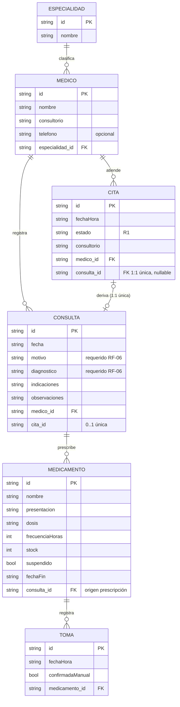
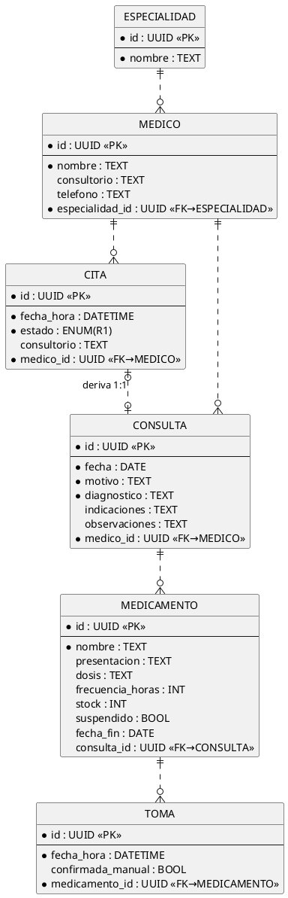

# 3. Modelo de datos — E-R, relacional y normalización

Diseño normalizado **v3**. Soporta todos los RF del doc 01 y las entidades
del diagrama de clases del doc 02 §2.5. La app lo implementa sobre la capa
`DB` (persistencia local); el esquema es el mismo que usaría un SQLite/PostgreSQL
real si se migrara a backend.

---

## 3.1 Modelo Entidad–Relación (E-R)

Cardinalidades_(leer _: la relación deriva se lee "una cita deriva a una consulta (0..1 ambos lados; única)")_.

### Mermaid (erDiagram)



### PlantUML (notación tipo Chen con atributos)



### Diagrama E-R clásico (Chen) — descripción de símbolos

```
[PACIENTE-IMPLÍCITO]          (el paciente es el usuario de la app; no es tabla)
        |
      (opera)
        |
        ▼
   [CITA] ——N———1——⟨atiende⟩——1—— [MÉDICO] ——N——1——⟨clasifica⟩—— [ESPECIALIDAD]
     |                              |
   ⟨deriva⟩ 1:1 única             ⟨registra⟩ 1:N
     |                              |
     ▼                              ▼
  [CONSULTA] ————⟨prescribe⟩ 1:N————→ [MEDICAMENTO]
                                          |
                                       ⟨registra⟩ 1:N
                                          ▼
                                       [TOMA]
```
Leyenda: `[rect]` entidad · `⟨rombo⟩` relación · `1/N` cardinalidad.

---

## 3.2 Modelo relacional (esquema v3 + DDL SQLite)

Relaciones: `especialidad(id, nombre)` · `medico(id, nombre, consultorio,
telefono, especialidad_id→especialidad)` · `cita(id, fecha_hora, estado,
consultorio, medico_id→medico)` · `consulta(id, fecha, motivo, diagnostico,
indicaciones, observaciones, medico_id→medico, cita_id 0..1 UNIQUE→cita)` ·
`medicamento(id, nombre, presentacion, dosis, frecuencia_horas, stock,
suspendido, fecha_fin, consulta_id→consulta)` · `toma(id, fecha_hora,
confirmada_manual, medicamento_id→medicamento)`.

```sql
-- ============ SaludApp esquema v3 (SQLite) ============
CREATE TABLE especialidad (
  id TEXT PRIMARY KEY,                       -- UUID
  nombre TEXT NOT NULL UNIQUE
);

CREATE TABLE medico (
  id TEXT PRIMARY KEY,
  nombre TEXT NOT NULL,
  consultorio TEXT,
  telefono TEXT,
  especialidad_id TEXT NOT NULL REFERENCES especialidad(id)
);

CREATE TABLE cita (
  id TEXT PRIMARY KEY,
  fecha_hora TEXT NOT NULL,                  -- ISO 8601
  estado TEXT NOT NULL DEFAULT 'Programada'
      CHECK (estado IN ('Programada','Confirmada','Atendida','Cancelada')),
  consultorio TEXT,
  medico_id TEXT NOT NULL REFERENCES medico(id)
);

CREATE TABLE consulta (
  id TEXT PRIMARY KEY,
  fecha TEXT NOT NULL,
  motivo TEXT NOT NULL,
  diagnostico TEXT NOT NULL,                 -- RF-06 obligatorio
  indicaciones TEXT,
  observaciones TEXT,
  medico_id TEXT NOT NULL REFERENCES medico(id),
  cita_id TEXT REFERENCES cita(id)  -- vínculo 1:1 (R2)
);

CREATE UNIQUE INDEX ux_consulta_cita ON consulta(cita_id) WHERE cita_id IS NOT NULL;

CREATE TABLE medicamento (
  id TEXT PRIMARY KEY,
  nombre TEXT NOT NULL,
  presentacion TEXT,
  dosis TEXT,
  frecuencia_horas INTEGER,
  stock INTEGER NOT NULL DEFAULT 0 CHECK (stock >= 0),   -- R3
  suspendido INTEGER NOT NULL DEFAULT 0,                 -- 0/1
  fecha_fin TEXT,
  consulta_id TEXT REFERENCES consulta(id)              -- origen prescripción
);

CREATE TABLE toma (
  id TEXT PRIMARY KEY,
  fecha_hora TEXT NOT NULL,
  confirmada_manual INTEGER NOT NULL DEFAULT 0,
  medicamento_id TEXT NOT NULL REFERENCES medicamento(id)
);

-- Índices de consulta frecuente
CREATE INDEX ix_cita_medico_fecha ON cita(medico_id, fecha_hora);        -- RF-02 traslapes
CREATE INDEX ix_cita_estado   ON cita(estado);
CREATE INDEX ix_consulta_fecha ON consulta(fecha DESC);
CREATE INDEX ix_toma_med      ON toma(medicamento_id, fecha_hora DESC);
CREATE INDEX ix_stock_bajo    ON medicamento(stock, suspendido);         -- RF-12
```

Restricciones de integridad más allá de las claves:
- `cita.estado` enum (CHECK) ⇒ R1 aplicable a nivel de esquema.
- `medicamento.stock ≥ 0` (CHECK) ⇒ R3.
- `consulta.cita_id` UNIQUE parcial ⇒ R2 (una cita apenas puede derivar una consulta).
- FKs con integridad referencial; borrado prohibido para entidades con historial (borrado real solo si no se referencia).

---

## 3.3 Normalización (proceso completo con el ejemplo real)

Partimos de una "hoja de registro" de papel llena por el recepcionista y la
normalizamos hasta 3FN.

### Forma no normalizada (FNN)

| campo |
|---|
| `hoja_consulta = { fecha, paciente, nombre_medico, especialidad, consultorio, motivo, diagnostico, indicaciones_texto, prescripciones_texto (lista repetida), tomas_texto (lista repetida) }` |

Ejemplo concreto de fila (con grupos repetidos):

| fecha | medico | especialidad | motivo | diagnostico | indicaciones | prescripciones | tomas |
|---|---|---|---|---|---|---|---|
| 2026-10-23 | Dr. Ramírez | Cardiología | control | hipertensión leve | descanso; comida blanda | `{ "losartán 50mg", "atorvastatina 20mg" }` | `{ "losartán 08:00", "losartán 20:00" }` |

### 1FN — atomicidad de campos

Todo valor es atómico; desaparecen los grupos repetidos/anidados.
**Violaciones de la FNN corregidas:** `prescripciones_texto` y `tomas_texto`
eras listas dentro de un campo.
→ 1FN: cada prescripción y cada toma viven en su propia fila/tabla.

```sql
-- 1FN (aún no óptimo)
reg_consulta(id, fecha, nombre_medico, especialidad, consultorio, motivo, diagnostico, indicaciones)
reg_prescripcion(id, consulta_id, nombre_medicamento, presentacion, dosis, stock)
reg_toma(id, prescripcion_id, fecha_hora)
```
Cuestión: `reg_consulta` sigue repitiendo datos del médico en cada consulta.
Aún no hay problema de 1FN (los campos son atómicos), pero sí redundancia.

### 2FN — nada depende de parte de la clave (para claves compuestas)

En `reg_prescripcion` la clave natural era compuesta `(consulta_id, nombre_medicamento)`.
Dato no clave: `presentacion` (p. ej., "tableta 50mg") **depende solo de la
medicina**, no de la consulta → **dependencia parcial**.
Si una medicina se prescribe 500 veces, su presentación se repite 500 veces.

```sql
-- Antes (2FN violada)
reg_prescripcion(consulta_id PK, nombre_medicamento PK, presentacion, dosis)
--                                       ^^^^^^^^^^^^^^^──── depends only on this part of the PK
```
→ 2FN: extraer el catálogo en `medicamento(id, nombre, presentacion, …)` y
que la prescripción referencie `medicamento_id`.

### 3FN — nada depende transitivamente de la clave

En `reg_consulta` los campos no clave dependen unos de otros:
`nombre_medico → consultorio, especialidad_médica`.
`especialidad` depende de `nombre_medico`, no de la consulta →
**dependencia transitiva** (consulta_id → medico → consultorio/especialidad).
Cambio de consultorio se tendría que actualizar en TODAS las consultas del médico.

```sql
-- Antes (3FN violada): consulta_id → nombre_medico → consultorio, especialidad
reg_consulta(id, fecha, nombre_medico, consultorio, especialidad, motivo, diagnostico, …)
-- Después (3FN): cada hecho depende solo de su propia clave
```
→ 3FN: `medico(id, nombre, consultorio, especialidad_id)` y
`especialidad(id, nombre)` independientes; `consulta` solo lleva `medico_id`.

El estado de v3 (§3.2) es el resultado: cada tabla guarda hechos que
dependen de su clave, de la clave completa y únicamente de la clave.

### Resumen paso a paso

| Paso | Problema que resuelve | Cambio aplicado |
|---|---|---|
| FNN→1FN | Listas anidadas en un campo | 1 tabla/vschema por grupo repetido: prescripción y toma aparte |
| 1FN→2FN | Dependencia parcial de `(consulta_id, nombre_medicamento)` | Catálogo `medicamento` independiente; FK `medicamento_id` |
| 2FN→3FN | Dependencia transitiva consulta→médico→especialidad/consultorio | Tablas `medico` y `especialidad` propias con FKs |

¿Se llega a BCNF? Sí: en v3 todo determinante es clave candidata
(`id` en cada tabla; `especialidad.nombre` UNIQUE es clave candidata de
`especialidad`; `consulta.cita_id` UNIQUE parcial hace 1:1). No quedan
determinantes que no sean superclaves → **la v3 está en BCNF**, forma aún
más estricta que 3FN.

### Por qué NO vamos más allá (por qué denormalizar 0 cosas)

No se denormaliza nada: los conteos tipo "cuántas tomas hoy" o "próxima
cita" se derivan con consultas sobre `toma`/`cita` sin guardar duplicados —
son agregados, no atributos. Redundancia deliberada con propósito de
rendimiento no estaba justificada a < 500 registros (RNF-02).

---

## 3.4 Diccionario de datos (v3)

| Tabla | Atributo | Tipo | Restricción | Semántica |
|---|---|---|---|---|
| especialidad | id | TEXT UUID | PK | identificador |
| especialidad | nombre | TEXT | NOT NULL UNIQUE | p. ej. "Cardiología" |
| medico | id | TEXT UUID | PK | |
| medico | nombre | TEXT | NOT NULL | "Dr. Ramírez" |
| medico | consultorio | TEXT | opcional | |
| medico | telefono | TEXT | opcional | |
| medico | especialidad_id | TEXT | FK→especialidad NOT NULL | |
| cita | id | TEXT UUID | PK | |
| cita | fecha_hora | TEXT ISO 8601 | NOT NULL | |
| cita | estado | TEXT | NOT NULL DEFAULT 'Programada' CHECK enum R1 | ciclo de vida |
| cita | consultorio | TEXT | opcional (puede heredar del médico) | |
| cita | medico_id | TEXT | FK→medico NOT NULL | |
| consulta | id | TEXT UUID | PK | |
| consulta | fecha | TEXT | NOT NULL | |
| consulta | motivo | TEXT | NOT NULL | porqué va |
| consulta | diagnostico | TEXT | NOT NULL (RF-06) | diagnóstico médico |
| consulta | indicaciones | TEXT | opcional (tratamiento) | |
| consulta | observaciones | TEXT | opcional | notas/signos |
| consulta | medico_id | TEXT | FK→medico NOT NULL | |
| consulta | cita_id | TEXT | FK→cita, UNIQUE parcial | R2 1:1 |
| medicamento | id | TEXT UUID | PK | |
| medicamento | nombre | TEXT | NOT NULL | |
| medicamento | presentacion | TEXT | opcional | "tableta 50mg" |
| medicamento | dosis | TEXT | opcional | "1 tableta" |
| medicamento | frecuencia_horas | INTEGER | opcional ≥ 1 | periodicidad |
| medicamento | stock | INTEGER | NOT NULL ≥ 0 (R3) | cant. restante |
| medicamento | suspendido | INTEGER 0/1 | NOT NULL default 0 | fin de tratamiento |
| medicamento | fecha_fin | TEXT | opcional | fin previsto (R4) |
| medicamento | consulta_id | TEXT | FK→consulta | origen del prescribe |
| toma | id | TEXT UUID | PK | |
| toma | fecha_hora | TEXT ISO 8601 | NOT NULL | cuando se tomó |
| toma | confirmada_manual | INTEGER 0/1 | NOT NULL default 0 | caso stock 0 con permiso |
| toma | medicamento_id | TEXT | FK→medicamento NOT NULL | |

## 3.5 Consultas típicas (muestreo para verificación RF)

```sql
-- RF-02 traslape: citas del mismo médico que tocan la franja
SELECT id FROM cita
WHERE medico_id = :m
  AND estado <> 'Cancelada'
  AND fecha_hora BETWEEN :inicio AND :fin;

-- RF-07 historial cronológico inverso
SELECT * FROM consulta ORDER BY fecha DESC, id DESC;

-- RF-11 adherencia del día de un medicamento
SELECT COUNT(*) FROM toma
WHERE medicamento_id = :med AND fecha_hora LIKE :dia || '%';

-- RF-12 stock bajo (activos con ≤ 2)
SELECT * FROM medicamento WHERE suspendido = 0 AND stock <= 2;
```
